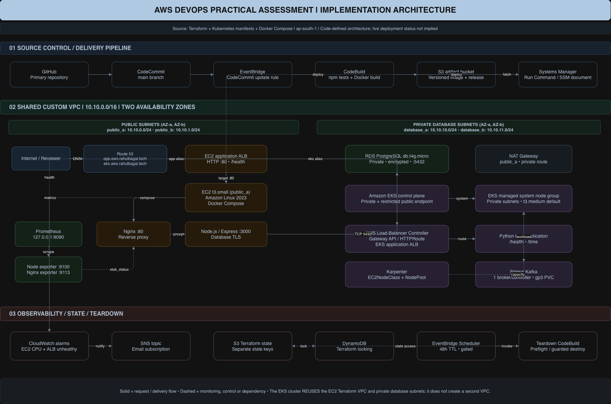

# AWS DevOps Practical Assessment

This repository is a hands-on AWS DevOps assessment. It has two independent runtime paths that share one custom VPC in `ap-south-1`. Every AWS resource and every Kubernetes object is provisioned with `terraform apply`.

| Path | Workload | Platform | Delivery |
| --- | --- | --- | --- |
| **EC2 path** (brief §4, §5, §7, §8) | Node.js 24 + Express clock with a PostgreSQL read/write endpoint | Docker Compose (Nginx + app + Prometheus + exporters) on one Amazon Linux 2023 EC2 instance behind an internet-facing ALB, with private RDS PostgreSQL | CodeCommit push → EventBridge → CodeBuild → S3 versioned artifacts → SSM Run Command |
| **EKS path** (brief §2) | Python (Flask + Gunicorn) clock | Amazon EKS: managed system node group, Karpenter `t3.medium` workload nodes, AWS Load Balancer Controller (Gateway API), Strimzi Kafka | CodeBuild pushes the image to ECR on every push. Terraform (`eks-workloads`) rolls it out |

Supporting capabilities: Terraform remote state in S3 with DynamoDB locking, a CodeCommit mirror of the GitHub repository, a Route 53 delegated subdomain, CloudWatch alarms that notify SNS, and an automatic TTL teardown (EventBridge Scheduler → Lambda → CodeBuild).

The authoritative specification is [`docs/assessment_brief.pdf`](docs/assessment_brief.pdf). This README describes what the code in this repository does. When the README says something is **verified**, it gives the evidence. Configuration that exists only in code is never described as operational.

---

## Contents

1. [Project Overview](#1-project-overview)
2. [Architecture](#2-architecture)
3. [Prerequisites](#3-prerequisites)
4. [Repository Structure](#4-repository-structure)
5. [AWS Configuration](#5-aws-configuration)
6. [Deployment Guide](#6-deployment-guide--step-by-step)
7. [Application Endpoints](#7-application-endpoints)
8. [Testing and Validation](#8-testing-and-validation)
9. [Troubleshooting](#9-troubleshooting)
10. [Design Decisions and Constraints](#design-decisions-and-constraints) · [Teardown, Cleanup and Cost](#10-teardown-cleanup-and-cost)
11. [Security Considerations](#11-security-considerations)
12. [Assessment Verification Checklist](#12-assessment-verification-checklist)
13. [Known Gaps](#13-known-gaps)

---

## 1. Project Overview

### Objectives (from the brief)

- Provision AWS infrastructure with Terraform only, with no console-created resources (§1, §10).
- Containerise a dynamic web application behind an Nginx reverse proxy that sets security headers (§4).
- Run a second, independent Python workload on EKS, exposed through the Kubernetes Gateway API, with Karpenter `t3.medium` workload capacity and a Strimzi Kafka cluster (§2).
- Mirror the source to CodeCommit, and build and deploy on every push (§3, §7).
- Monitor with CloudWatch alarms that notify SNS, plus Prometheus scraping node and Nginx metrics (§8).
- Tear everything down automatically after a configurable TTL (default 48 hours) (§6).

### Implemented capabilities

| Capability | Implementation |
| --- | --- |
| Remote state | S3 bucket (versioned, SSE-S3, TLS-only, public access blocked) + DynamoDB `LockID` table: `infrastructure/terraform/bootstrap` |
| Source mirror | CodeCommit repository `aws-devops-practical-assessment` (bootstrap stack) |
| Network | VPC `10.10.0.0/16`, 2 public + 2 private subnets in two AZs, IGW, route tables, one NAT gateway: `ec2/main.tf` |
| EC2 workload | `t3.small` AL2023 instance in `public_a`, IMDSv2 required, encrypted gp3 root, SSM-managed. Port 22 is closed unless `enable_reviewer_ssh = true`, and then open only to `reviewer_ssh_cidr` |
| Load balancing | Internet-facing ALB, HTTP :80, target health check on `/health` |
| Database | RDS PostgreSQL `db.t4g.micro`, private subnets, SG open only to the EC2 SG, encrypted. Master password managed by RDS in Secrets Manager. App credential generated during apply as a **write-only** value (never in state) |
| CI/CD | EventBridge rule on CodeCommit `main` → CodeBuild (`buildspec.yml`): tests, Docker build, S3 artifacts, SSM deployment to EC2, then the Python image pushed to ECR |
| EKS | Cluster in the **existing** VPC's private subnets, managed `system` node group, add-ons vpc-cni, coredns, kube-proxy, eks-pod-identity-agent, aws-ebs-csi-driver, access entries for reviewers and the teardown executor |
| Karpenter | IAM/SQS/EventBridge from the upstream CloudFormation template **deployed by Terraform**. Helm release. `EC2NodeClass` + `NodePool` restricted to `t3.medium`. The Python workload is scheduled on that NodePool |
| Gateway API | Gateway API CRDs + AWS Load Balancer Controller (Helm, Pod Identity), `GatewayClass aws-alb`, `Gateway`, `HTTPRoute`, `LoadBalancerConfiguration`, `TargetGroupConfiguration` |
| Kafka | Strimzi operator (Helm chart `1.2.0`), KRaft single combined broker/controller on gp3 EBS, topic `assessment-events` |
| DNS | Route 53 hosted zone `aws.rahulbagal.tech` (delegated from the registrar), `app.` → EC2 ALB, `eks.` → Gateway ALB (read from the Gateway's status) |
| Monitoring | CloudWatch alarms for EC2 CPU > 80% and ALB `UnHealthyHostCount` > 0 → SNS email. Prometheus + node_exporter + nginx-prometheus-exporter in Compose |
| Teardown | EventBridge Scheduler one-time `at(start + TTL_HOURS)` → Lambda trigger → CodeBuild ordered `terraform destroy` of all stacks, with tag-scoped sweeps for controller-created resources |

### Technologies and pinned versions

| Component | Version | Source |
| --- | --- | --- |
| Terraform | `= 1.15.8` (all stacks) | `versions.tf` |
| Providers | aws `= 6.21.0`, helm `= 3.3.0`, kubernetes `= 3.3.0`, random `= 3.9.1`, archive `= 2.8.1` | `versions.tf`, `.terraform.lock.hcl` |
| Node.js app image | `public.ecr.aws/docker/library/node:24.11.1-bookworm-slim`, Express `5.1.0`, pg `8.16.3` | `app/` |
| Python app image | `python:3.12-slim`, Flask `3.1.1`, Gunicorn `23.0.0` | `apps/python-time/` |
| Nginx / Prometheus / exporters | `nginx:1.28.0-alpine`, `prom/prometheus:v3.5.0`, `prom/node-exporter:v1.9.1`, `nginx/nginx-prometheus-exporter:1.4.2` | `docker-compose.yml` |
| Docker Compose on EC2 | `2.39.4` (SHA-256 verified) | `scripts/host/bootstrap.sh` |
| CodeBuild image | `aws/codebuild/standard:7.0`, Node.js runtime 24 | `cicd/codebuild.tf`, `buildspec.yml` |
| Gateway API CRDs | vendored `standard-install.yaml` (version in its `bundle-version` annotation) | `infrastructure/kubernetes/gateway-api/` |
| Load Balancer Controller / Karpenter charts | `lbc_chart_version` / `karpenter_chart_version` inputs (no defaults: pin explicitly) | `eks-addons/variables.tf` |
| Strimzi chart | `1.2.0` | `eks-addons/variables.tf` |

---

## 2. Architecture



[Edit Architecture Diagram](docs/architecture/aws-assessment-actual-architecture.drawio). Open it in [diagrams.net](https://app.diagrams.net/).

> [!NOTE]
> The diagram predates the `eks-addons`/`eks-workloads` split and the Lambda trigger. The resources and flows it shows are unchanged.

### Shared VPC: EC2 and EKS

There is **one** VPC. The EKS stack creates no network resources. It reads the VPC and private subnets created by the EC2 stack through `data "aws_vpc"` / `data "aws_subnet"` lookups (`eks/network.tf`). A `check` block asserts that both subnets belong to that VPC and span two AZs.

| Subnet key (EC2 stack) | CIDR | Route | Used by |
| --- | --- | --- | --- |
| `public_a` | `10.10.0.0/24` | IGW | EC2 instance, EC2 ALB, NAT gateway, Gateway ALB |
| `public_b` | `10.10.1.0/24` | IGW | EC2 ALB, Gateway ALB |
| `database_a` | `10.10.10.0/24` | NAT in `public_a` | RDS, EKS control-plane ENIs, system and Karpenter nodes |
| `database_b` | `10.10.11.0/24` | NAT in `public_a` | RDS subnet group, EKS control-plane ENIs, system and Karpenter nodes |

The two private subnets are named `database_*` and are reused for EKS. Egress goes through a single zonal NAT gateway, which is not a highly available design. Because EKS lives in subnets owned by the EC2 state, **EKS is always destroyed before EC2**.

### Terraform stacks and how they relate

All stacks share one S3 bucket and DynamoDB lock table, each with its own key. Cross-stack values flow through `terraform_remote_state`, never through copied IDs (except the EKS VPC inputs, which you take from ec2 outputs).

| # | Stack | State key | Owns | Reads |
| --- | --- | --- | --- | --- |
| 1 | `bootstrap` | `bootstrap/terraform.tfstate` | State bucket, lock table, CodeCommit, optional Route 53 delegation set | — |
| 2 | `teardown` | `teardown/terraform.tfstate` | Scheduler, Lambda trigger, CodeBuild destroy project, IAM | — (the executor reads all keys at run time) |
| 3 | `ec2` | `ec2/terraform.tfstate` | VPC, ALB, EC2, RDS, artifacts bucket, secrets, SSM document, SNS, alarms | — |
| 4 | `cicd` | `cicd/terraform.tfstate` | CodeBuild app project, EventBridge rule, ECR repository | ec2 |
| 5 | `route53` | `route53/terraform.tfstate` | Hosted zone, `app.` record | ec2 |
| 6 | `eks` | `eks/terraform.tfstate` | Cluster, node group, add-ons, Karpenter IAM (CloudFormation), LBC identity, access entries | VPC/subnet inputs |
| 7 | `eks-addons` | `eks-addons/terraform.tfstate` | Gateway API CRDs, LBC, Karpenter and Strimzi Helm releases | eks |
| 8 | `eks-workloads` | `eks-workloads/terraform.tfstate` | Namespace, gp3 class, NodePool/EC2NodeClass, Deployment/Service, Gateway/HTTPRoute, Kafka, `eks.` record | eks, cicd, route53 |

`eks-addons` and `eks-workloads` are separate because Kubernetes custom resources can only be planned once their CRDs exist.

**Why S3 (brief §5).** Two buckets, each with one job:

1. **Terraform remote state** (bootstrap). With the DynamoDB lock table, an ephemeral executor such as the teardown CodeBuild can read and lock state and destroy everything without a laptop's local files. It is versioned for recovery, encrypted, TLS-only and never deleted by teardown.
2. **Deployment artifacts** (ec2). CodeBuild uploads each commit's source archive and Docker image to `applications/<sha>.tar.gz` and `images/<sha>.tar.gz`, and the EC2 host fetches them by exact version ID and SHA-256 over SSM. Builds are immutable and rollbackable, and the instance needs no registry or Git credentials. The bucket is private, versioned and disposable (`force_destroy`).

Application logs stay in CloudWatch and on the host rather than in S3.

### Request and control flows

- **EC2 request:** client → `app.aws.rahulbagal.tech` → ALB :80 → EC2 :80 (SG: only from the ALB SG) → Nginx → `app:3000` → RDS :5432 (SG: only from the EC2 SG) over TLS `verify-full`.
- **EKS request:** client → `eks.aws.rahulbagal.tech` → Gateway ALB → `HTTPRoute` → `Service python-time` → pods (IP targets, health check `/health`) on Karpenter `t3.medium` nodes.
- **Delivery:** `git push codecommit main` → EventBridge → CodeBuild: `npm ci && npm test` → `docker build` → S3 artifacts → `ssm send-command` → host verifies hashes and restarts Compose → Python image pushed to ECR as `<sha>` and `latest`.
- **Monitoring:** Prometheus (`127.0.0.1:9090` on the host only) scrapes `node-exporter:9100` and `nginx-exporter:9113`. CloudWatch alarms publish to SNS.
- **Teardown:** Scheduler (at the deadline) → Lambda → CodeBuild → `terraform destroy` per stack in order (see [§10](#10-teardown-cleanup-and-cost)).

---

## 3. Prerequisites

### Required tools

"Tested" lists the versions on the workstation used to write and check this README (macOS arm64, 2026-10-13).

| Tool | Required version | Tested | Needed for |
| --- | --- | --- | --- |
| Terraform | **exactly 1.15.8** | 1.15.8 | All stacks |
| AWS CLI v2 | v2 (also used by the Kubernetes/Helm providers for EKS tokens) | 2.36.13 | Credentials, EKS auth, verification |
| Git | any recent | 2.54.0 | Clone, CodeCommit push |
| Docker | any recent | 29.8.2 | Local image builds and Compose validation (CI builds the deployed images) |
| Python 3 | ≥ 3.9 | 3.14.3 | Helper scripts and unit tests |
| Node.js | 24.x | 24.11.1 | App unit tests |

### Optional tools

| Tool | Purpose |
| --- | --- |
| kubectl | Inspecting the cluster and the Kafka round-trip check (Terraform itself does not need it) |
| Helm | Inspecting releases (Terraform uses the Helm provider, not the CLI) |
| AWS Session Manager plugin | `aws ssm start-session` and port-forwarding to Prometheus |
| `dig` | DNS verification |

### AWS account and permissions

- One AWS account and **`ap-south-1`**. Every stack validates the region and uses `allowed_account_ids`.
- An operator identity that can create and destroy: S3, DynamoDB, CodeCommit, VPC/EC2/ELBv2, RDS, Secrets Manager, SSM, IAM, CloudWatch, SNS, CodeBuild, EventBridge and Scheduler, Lambda, EKS, ECR, CloudFormation, SQS and Route 53.
- Quotas for one `t3.small`, two `t3.medium` system nodes plus Karpenter `t3.medium` capacity (NodePool CPU limit 8), one `db.t4g.micro`, two ALBs, one NAT gateway and one Elastic IP.

### Domain and Route 53

The `route53` stack creates the hosted zone `domain_name` (default `aws.rahulbagal.tech`). The parent domain is registered outside AWS, so **once**, at the registrar, create `NS` records for the subdomain that point to the zone's four `name_servers`. That is the only DNS step outside Terraform. Set `create_delegation_set = true` in bootstrap and pass its ID to `route53` to keep the same name servers when the zone is destroyed and recreated.

---

## 4. Repository Structure

```text
.
├── buildspec.yml                       # CodeBuild: test, build, deploy EC2 via SSM, push Python image to ECR
├── docker-compose.yml                  # app, nginx, node-exporter, nginx-exporter, prometheus (config embedded)
├── app/                                # EC2 workload: Express app, Dockerfile, tests, schema
├── apps/python-time/                   # EKS workload: Flask app, Dockerfile
├── nginx/default.conf                  # Reverse proxy, security headers, internal stub_status :8080
├── monitoring/prometheus.yml           # Reference copy of the scrape config embedded in docker-compose.yml
├── kubernetes/python-time/             # Namespace, Deployment + Service (templated: image, Karpenter nodeSelector)
├── infrastructure/
│   ├── kubernetes/
│   │   ├── aws-load-balancer-controller/   # IAM policy, Pod Identity trust policy, Helm values (templated)
│   │   ├── gateway-api/                    # Gateway API + AWS Gateway CRDs, GatewayClass/Gateway/HTTPRoute, TG config
│   │   ├── kafka/                          # KafkaNodePool/Kafka/KafkaTopic, verify-roundtrip.sh
│   │   └── storage/gp3.yaml                # EBS CSI gp3 StorageClass (Kafka PVC)
│   └── terraform/
│       ├── bootstrap/  teardown/  ec2/  cicd/  route53/
│       ├── eks/                            # Cluster, node group, add-ons, identities, access entries
│       │   └── karpenter/                  # Upstream IAM/SQS CloudFormation template, EC2NodeClass + NodePool (templated)
│       ├── eks-addons/                     # CRDs + Helm releases
│       └── eks-workloads/                  # Kubernetes objects from the committed manifests + eks. DNS record
├── scripts/
│   ├── host/bootstrap.sh                   # EC2 user data: Docker, Compose, SSM agent, /opt/assessment
│   ├── deploy/                             # Artifact packaging, SSM coordinator, host deploy/rollback, ECR push
│   ├── database/                           # DB role/schema initialisation, integration test harness
│   └── teardown/                           # Ordered destroy executor (destroy.py), buildspec, pinned Terraform installer
└── docs/                                   # assessment_brief.pdf, architecture diagram
```

Kubernetes manifests stay plain YAML in the repository (brief §2 deliverables). Terraform renders a few values into them with `templatefile` and applies each document with `kubernetes_manifest`.

---

## 5. AWS Configuration

```bash
aws configure sso                     # or export AWS_PROFILE=<profile>; never commit credentials
export AWS_REGION=ap-south-1 AWS_DEFAULT_REGION=ap-south-1
aws sts get-caller-identity --query '{Account:Account,Arn:Arn}' --output table

export ACCOUNT_ID="$(aws sts get-caller-identity --query Account --output text)"
export STATE_BUCKET="<globally-unique-state-bucket>"
export LOCK_TABLE="aws-devops-assessment-locks"
export MY_CIDR="$(curl -s https://checkip.amazonaws.com)/32"
```

Every stack has `terraform.tfvars.example` and `backend.hcl.example`. Copy them to `terraform.tfvars` and `backend.hcl` (both are git-ignored) and replace the placeholders. Each `backend.hcl` differs only in `key` (see the table in §2).

Read-only look-ups for the ec2 and eks inputs:

```bash
aws ssm get-parameter --name /aws/service/ami-amazon-linux-latest/al2023-ami-kernel-default-x86_64 \
  --query Parameter.Value --output text                                   # reviewed_ami_id
aws rds describe-orderable-db-instance-options --engine postgres --db-instance-class db.t4g.micro \
  --query 'OrderableDBInstanceOptions[?StorageType==`gp3`].EngineVersion' --output text | tr '\t' '\n' | sort -uV | tail -3   # postgres_version
aws eks describe-cluster-versions --query 'clusterVersions[].clusterVersion' --output text   # kubernetes_version
```

No secret is ever a Terraform input. RDS generates the master password. With `manage_application_secret_value = true`, the ec2 stack generates the application credential as an ephemeral value and stores it through a **write-only** argument, so it never appears in plan or state files.

---

## 6. Deployment Guide — Step by Step

> [!IMPORTANT]
> Every apply creates billable resources. For each stack: `terraform init -backend-config=backend.hcl`, then `terraform plan -out=tfplan`, review the plan, then `terraform apply tfplan`. Commands below use the helper `tfa` for that sequence:
>
> ```bash
> tfa() { terraform -chdir="infrastructure/terraform/$1" init -backend-config=backend.hcl -input=false &&
>         terraform -chdir="infrastructure/terraform/$1" plan -out=tfplan &&
>         read -rp "Apply this plan to $1? [y/N] " ok && [ "$ok" = y ] &&
>         terraform -chdir="infrastructure/terraform/$1" apply tfplan; }
> tfo() { terraform -chdir="infrastructure/terraform/$1" output "${@:2}"; }
> ```

### Phase 1 — Bootstrap (state backend, CodeCommit)

The bootstrap stack creates the bucket that later holds its own state, so the first apply uses local state and then migrates it (`backend.tf.example` describes this).

```bash
cd infrastructure/terraform/bootstrap
cp terraform.tfvars.example terraform.tfvars && cp backend.hcl.example backend.hcl   # fill both
mv backend.tf backend.tf.disabled && terraform init && terraform plan -out=tfplan && terraform apply tfplan
mv backend.tf.disabled backend.tf && terraform init -migrate-state -backend-config=backend.hcl
cd ../../..

# Mirror the repository to CodeCommit (brief §3)
git config --local credential.https://git-codecommit.ap-south-1.amazonaws.com.helper '!aws codecommit credential-helper $@'
git config --local credential.https://git-codecommit.ap-south-1.amazonaws.com.UseHttpPath true
git remote add codecommit "$(tfo bootstrap -raw codecommit_clone_url_https)"
git push codecommit main
```

**Verify:** `aws s3api get-bucket-versioning --bucket "$STATE_BUCKET"` returns `Enabled`; `aws dynamodb describe-table --table-name "$LOCK_TABLE"` returns `ACTIVE`; `git rev-parse HEAD codecommit/main` shows matching SHAs.

### Phase 2 — Teardown foundation (schedule created disabled)

Applied early so the TTL clock exists from the start, and so its executor role can be granted EKS access in Phase 6.

```bash
# terraform.tfvars: DEPLOYMENT_STARTED_AT (fixed UTC, e.g. repository access grant), TTL_HOURS = 48,
# TEARDOWN_ENABLED = false, EXECUTION_MODE = "PREFLIGHT_ONLY", AWS_ACCOUNT_ID, DEPLOYMENT_ID,
# EC2_DEPLOYMENT_ID, EKS_CLUSTER_NAME (<eks deployment_id>-eks), BACKEND_BUCKET, LOCK_TABLE
tfa teardown
tfo teardown -raw destroy_role_arn     # used in Phase 6
tfo teardown expiry_time
```

### Phase 3 — EC2 infrastructure (shared VPC, ALB, EC2, RDS, alarms)

```bash
# terraform.tfvars: expected_account_id, deployment_id, reviewer_ssh_cidr, reviewed_ami_id, postgres_version,
# monitoring_interviewer_email, manage_application_secret_value = true, enable_reviewer_ssh = false
tfa ec2
tfo ec2
```

**Creates:** everything in the ec2 row of §2, including SNS topic `<deployment_id>-alerts` with the email subscription, and alarms `<deployment_id>-ec2-high-cpu` and `<deployment_id>-alb-unhealthy-targets`. The ALB target stays unhealthy until the first CI deployment (Phase 4).

**Verify:** `aws ssm describe-instance-information --filters "Key=InstanceIds,Values=$(tfo ec2 -raw instance_id)" --query 'InstanceInformationList[].PingStatus'` returns `["Online"]`.

### Phase 4 — CI/CD and first deployment

```bash
# terraform.tfvars: expected_account_id, deployment_id (same as ec2), state_bucket
tfa cicd
git push codecommit main          # triggers the pipeline
```

**What the first build does:** runs `npm ci && npm test`, builds the image, uploads `applications/<sha>.tar.gz` and `images/<sha>.tar.gz` to S3, and sends the SSM deployment. The host has no runtime configuration yet, so `scripts/deploy/prepare.py` initialises the database itself: it reads both secrets, creates role `assessment_app` and table `messages` over TLS, and writes `/opt/assessment/runtime/app.env` (root, 0600). The build then pushes `eks-python-time:<sha>` and `:latest` to ECR. Later pushes reuse the runtime configuration.

```bash
PROJECT="$(tfo ec2 -json destroy_inputs | python3 -c 'import json,sys;print(json.load(sys.stdin)["deployment_id"])')-app-build"
aws codebuild batch-get-builds --ids "$(aws codebuild list-builds-for-project --project-name "$PROJECT" --query 'ids[0]' --output text)" \
  --query 'builds[0].{Status:buildStatus,Source:resolvedSourceVersion}'
aws logs tail "/aws/codebuild/$PROJECT" --since 1h
ALB=$(tfo ec2 -raw alb_dns_name)
curl -s "http://$ALB/health"; curl -s "http://$ALB/time"
curl -s -X POST "http://$ALB/messages" -H 'Content-Type: application/json' -d '{"text":"hello"}'   # 201: RDS write + read
```

**Rollback:** every release is kept under `/opt/assessment/releases/<sha>-<digest>` with its own image tag. Push (or re-run CodeBuild for) the previous commit to redeploy it. Never edit the host by hand.

### Phase 5 — DNS zone and EC2 record

```bash
# terraform.tfvars: expected_account_id, state_bucket, domain_name, app_record_name (, delegation_set_id)
tfa route53
tfo route53 name_servers          # once: NS records for the subdomain at the registrar
dig +short "app.$(tfo route53 -raw domain_name)"
```

### Phase 6 — EKS cluster

```bash
# terraform.tfvars: expected_account_id, deployment_id, vpc_id + private_subnet_ids (from: tfo ec2 vpc_id / subnet_ids
# database_a, database_b), kubernetes_version, cluster_public_access_cidrs = ["<MY_CIDR>"],
# reviewer_principal_arns = [...], teardown_role_arn = "<Phase 2 output>"
tfa eks
$(tfo eks -raw kubectl_access_command)
kubectl get nodes -L eks.amazonaws.com/nodegroup
```

**Creates:** the cluster, the `system` node group (2 × `t3.medium`, label `workload=system`, for controllers and Kafka), the add-ons, the Karpenter CloudFormation stack (node role, controller policies, interruption queue), the Karpenter and Load Balancer Controller Pod Identity associations, and the access entries. Reviewers get cluster-admin through `reviewer_principal_arns` so they can run the Kafka check. Their IP must also be in `cluster_public_access_cidrs`.

### Phase 7 — EKS add-ons

```bash
# terraform.tfvars: expected_account_id, state_bucket, lbc_chart_version, karpenter_chart_version
tfa eks-addons
tfo eks-addons helm_releases
```

**Installs:** the Gateway API CRDs (plus the AWS Gateway CRDs), then the AWS Load Balancer Controller (feature gate `ALBGatewayAPI`), Karpenter and the Strimzi operator.

### Phase 8 — EKS workloads, Gateway, Kafka, EKS DNS

```bash
# terraform.tfvars: expected_account_id, state_bucket, python_image_tag (latest or a commit SHA)
tfa eks-workloads
tfo eks-workloads eks_app_url
```

**Applies:** the committed manifests: namespace, gp3 class, `EC2NodeClass`/`NodePool assessment` (t3.medium only), the `python-time` Deployment (nodeSelector `karpenter.sh/nodepool: assessment`) and Service, the TargetGroup/LoadBalancer configuration, `GatewayClass`, `Gateway` (Terraform waits for `Programmed=True`) and `HTTPRoute`, then `KafkaNodePool`, `Kafka` (waits for `Ready`) and `KafkaTopic`. It finishes with the `eks.` alias record pointing at the address in the Gateway's status.

**Real-time refresh:** the page at `/` runs a small JavaScript loop that calls `fetch('/time')` every 1000 ms and writes the UTC ISO timestamp into `#clock`.

**Verify (brief §2):**

```bash
kubectl get nodeclaims -o wide                                   # Karpenter-launched claims
kubectl get nodes -L karpenter.sh/nodepool,node.kubernetes.io/instance-type
kubectl -n python-time get pods -o wide                          # pods on the Karpenter node(s)
kubectl -n python-time get gateway,httproute
curl -s "$(tfo eks-workloads -raw eks_app_url)/time"
bash infrastructure/kubernetes/kafka/verify-roundtrip.sh         # PASS: Kafka topic round-trip
```

### Phase 9 — Monitoring checks

The SNS recipient must click the AWS confirmation email; until then the subscription is `PendingConfirmation`.

```bash
TOPIC=$(tfo ec2 -raw assessment_alert_topic_arn)
aws sns list-subscriptions-by-topic --topic-arn "$TOPIC" --query 'Subscriptions[].SubscriptionArn'
INSTANCE_ID=$(tfo ec2 -raw instance_id)
CMD=$(aws ssm send-command --instance-ids "$INSTANCE_ID" --document-name AWS-RunShellScript \
  --parameters '{"commands":["curl -s http://127.0.0.1:9090/api/v1/targets"]}' --query Command.CommandId --output text)
sleep 5; aws ssm get-command-invocation --command-id "$CMD" --instance-id "$INSTANCE_ID" --query StandardOutputContent --output text \
  | python3 -c 'import json,sys; [print(t["labels"]["job"], t["health"]) for t in json.load(sys.stdin)["data"]["activeTargets"]]'
# node_exporter up / nginx_exporter up
```

Prometheus is published only on `127.0.0.1:9090` and is not reachable through the ALB. The scrape configuration is embedded in `docker-compose.yml` because the deployment artifact has a fixed file list.

### Phase 10 — Arm the TTL

```bash
terraform -chdir=infrastructure/terraform/teardown plan -var TEARDOWN_ENABLED=true -var EXECUTION_MODE=DESTROY -out=tfplan
terraform -chdir=infrastructure/terraform/teardown apply tfplan
aws scheduler get-schedule --name <DEPLOYMENT_ID> --group-name <DEPLOYMENT_ID> --query '{State:State,At:ScheduleExpression}'
```

Persist the two values in the teardown `terraform.tfvars` so later plans keep them.

### Adopting an environment that was built by hand

`cicd`, `eks`, `eks-addons` and `eks-workloads` contain conditional `import` blocks that adopt resources created earlier with the AWS CLI, `helm` or `kubectl`: the ECR repository, the Karpenter CloudFormation stack, the LBC role, policy and Pod Identity association, the Karpenter node access entry, Helm releases, CRDs, Kubernetes objects and the `eks.` record. Set `adopt_existing_resources = true` (and, for `eks`, `lbc_iam_role_name`, `lbc_iam_policy_name` and `existing_lbc_pod_identity_association_id` with the existing values). Then apply in stack order and **accept only plans with no `delete`**. The `route53` stack hands the `eks.` record over to `eks-workloads` with a `removed { destroy = false }` block, so the record is never deleted. Imports are no-ops once resources are in state, and the teardown executor always sets the flag to `false`.

---

## 7. Application Endpoints

| Name | URL | Paths | Status |
| --- | --- | --- | --- |
| EC2 app | `http://app.aws.rahulbagal.tech` | `/`, `/time`, `/health`, `POST /messages` | Read-only check 2026-10-13: `/health` 200, `/time` 200, security headers present |
| EKS app | `http://eks.aws.rahulbagal.tech` | `/`, `/time`, `/health` | Read-only check 2026-10-13: `/health` 200, `/time` 200 |
| EC2 ALB / Gateway ALB | `tfo ec2 -raw alb_dns_name` / `tfo eks-workloads -raw gateway_alb_dns_name` | as above | Per deployment |
| Prometheus | `http://127.0.0.1:9090` on the EC2 host | `/targets` | SSM only |

HTTPS is not configured (HTTP :80 only), so HSTS is intentionally omitted (brief §4 requires it only if TLS is in scope).

| Method | Path (EC2 app) | Response |
| --- | --- | --- |
| GET | `/` | HTML clock; `public/clock.js` polls `/time` every second and writes it with `textContent` |
| GET | `/time` | `{"timestamp":"<ISO-8601>"}`, `Cache-Control: no-store` |
| GET | `/health` | `{"status":"ok"}` |
| POST | `/messages` | `{"text":"1–200 chars"}` → parameterised INSERT + SELECT → `201`. `400` invalid, `413` > 4 KB, `503` DB error |

---

## 8. Testing and Validation

| Area | Command | Result 2026-10-13 |
| --- | --- | --- |
| Express app | `npm ci --prefix app && npm test --prefix app` | 4/4 pass |
| DB initialiser | `node --test scripts/database/test_initialize.cjs` | 6/6 pass |
| Deploy helpers | `PYTHONPATH=scripts/deploy python3 -m unittest discover -s scripts/deploy -p 'test_*.py'` | 16 OK |
| Database helpers | `PYTHONPATH=scripts/database python3 -m unittest discover -s scripts/database -p 'test_*.py'` | 17 OK |
| Host bootstrap | `PYTHONPATH=scripts/host python3 -m unittest discover -s scripts/host -p 'test_*.py'` | 7 OK |
| Teardown executor | `PYTHONPATH=scripts/teardown python3 -m unittest discover -s scripts/teardown -p 'test_*.py'` | 11 OK |
| TTL Lambda | `(cd infrastructure/terraform/teardown/lambda && python3 -m unittest test_trigger)` | 5 OK |
| Terraform fmt | `terraform fmt -check -recursive infrastructure/terraform` | clean |
| Terraform validate | `terraform -chdir=infrastructure/terraform/<stack> validate` | all 8 stacks valid |
| Terraform tests | `terraform -chdir=infrastructure/terraform/ec2 test`, `.../teardown test` (mock providers) | 19/19, 13/13 pass |
| Compose render | `PGHOST=x PGDATABASE=a PGUSER=x PGPASSWORD=x docker compose config --quiet` | exit 0 |

The teardown executor tests cover:
- the destroy order;
- preflight never mutating anything;
- the executor's endpoint access being opened before the Kubernetes stacks;
- sweeps limited to resources tagged for the cluster;
- skipping stacks with no state;
- the single retry;
- the account guard.

The Python EKS app has no unit tests (`python3 -m py_compile apps/python-time/app.py`). `scripts/database/run_integration.py` is an optional Docker harness that expects existing local review containers.

**Infrastructure checks:** `terraform plan -detailed-exitcode` per stack (exit `0` = no drift), the Phase 4/8/9 verification commands, and §12.

---

## 9. Troubleshooting

| Area | Diagnostic | Interpretation |
| --- | --- | --- |
| Backend init | `terraform init -reconfigure -backend-config=backend.hcl` | `NoSuchBucket`: wrong bucket. A `dynamodb_table` deprecation warning is expected; locking still uses the table |
| State lock | `aws dynamodb scan --table-name "$LOCK_TABLE" --projection-expression LockID` | Stale lock after a crash: confirm no run is active, then `terraform force-unlock <ID>` |
| IAM / account | `aws sts get-caller-identity` | `allowed_account_ids` error = wrong account. Decode `UnauthorizedOperation` with `aws sts decode-authorization-message` |
| Remote state output missing | `tfo <upstream-stack>` | Apply upstream stacks first (order in §2) |
| CodeBuild | `aws logs tail /aws/codebuild/<deployment_id>-app-build` | `PRE_BUILD` failure = tests. `BUILD`: Docker, S3, SSM or the ECR push (runs after the EC2 deployment) |
| SSM deployment | `aws ssm list-command-invocations --instance-id "$INSTANCE_ID" --details --max-items 3` | `Undeliverable` = agent offline. *"details withheld"* = inspect the host with `aws ssm start-session` (`sudo docker ps -a`, `sudo ls -l /opt/assessment`) |
| ALB health | `aws elbv2 describe-target-health --target-group-arn "$(tfo ec2 -raw target_group_arn)"` | `ResponseCodeMismatch`: app failing behind Nginx. `Timeout`: Compose down |
| RDS | App returns `503` on `/messages` | Check that the secret is populated (`aws secretsmanager describe-secret`), the CA checksum, and the role grants |
| kubectl / providers | `aws eks describe-cluster --name <cluster> --query cluster.resourcesVpcConfig.publicAccessCidrs` | Timeouts: your IP is not allowed (update `cluster_public_access_cidrs`). `Unauthorized`: no access entry |
| CRD not found on plan | `eks-workloads` plan error | Apply `eks-addons` first |
| Gateway | `kubectl -n python-time describe gateway python-time-gateway`; `kubectl -n kube-system logs deploy/aws-load-balancer-controller --tail=100` | No `Programmed`: CRDs, feature gate or LBC IAM |
| Karpenter | `kubectl get nodeclaims`; `kubectl -n kube-system logs deploy/karpenter --tail=100` | Claim never Ready: node access entry or IAM. Pods Pending: NodePool CPU limit or quota |
| Kafka | `kubectl -n kafka get kafka,pvc`; `kubectl -n kafka logs deploy/strimzi-cluster-operator --tail=100` | PVC Pending: gp3 class or EBS CSI add-on |
| DNS | `dig +trace app.<domain>` | Trace stops at the registrar: NS records missing |
| SNS | `aws sns list-subscriptions-by-topic --topic-arn "$TOPIC"` | `PendingConfirmation`: the recipient has not confirmed |
| Teardown | `aws logs tail /aws/lambda/<DEPLOYMENT_ID>-ttl-trigger`; `aws logs tail /aws/codebuild/<DEPLOYMENT_ID>-destroy` | Lambda `deadline not reached`: early invocation. `[teardown] stopped: …` names the failing stack or guard |

---

## Design Decisions and Constraints

Brief §11 leaves the app stack, destroy pattern and deployment mechanism open. This section records the choices and their trade-offs, plus one account constraint.

| Topic | Decision | Why / trade-off |
| --- | --- | --- |
| App stack (§4, §2) | Node.js 24 + Express on EC2; Python (Flask + Gunicorn) on EKS | Two independent paths as §2 requires (the EKS app must be Python). Both are minimal JSON `/time` + `/health` apps, so the infrastructure stays the focus |
| Nginx exposure (§4) | Behind the ALB, not on a direct public IP | One health-checked entry point, and the instance accepts port 80 only from the ALB SG. Route 53 aliases the ALB |
| Deployment mechanism (§7) | SSM Run Command with versioned, SHA-256-checked S3 artifacts | No SSH or inbound management ports. Every release is a commit SHA, so rollback is a redeploy of an earlier commit. Trade-off: images travel as S3 archives instead of through a registry |
| Destroy pattern (§6) | EventBridge Scheduler → Lambda trigger → CodeBuild executor | Lambda cannot conveniently run Terraform; CodeBuild can, against the shared S3 state and DynamoDB lock table. The Lambda only checks the deadline and starts the build. Trade-off: the backend and executor are retained after teardown (needed so destroy can run from an ephemeral executor, §5) |
| Port 22 (§5) | Closed by default; `enable_reviewer_ssh = true` opens it to `reviewer_ssh_cidr` only | "Open only on 80/443 and 22" is an upper bound. SSM Session Manager gives audited shell access without an inbound port |
| TLS / HSTS (§4) | HTTP only, no HSTS | The brief requires HSTS only when TLS is in scope |
| EKS baseline nodes (§2) | Managed `system` node group (`node_instance_type`, `t3.small` in the assessment account) for controllers and Kafka | The brief allows a small system node group. Workload capacity comes from Karpenter |
| Kubernetes objects | Committed YAML manifests rendered by Terraform (`kubernetes_manifest`), split into `eks-addons` and `eks-workloads` | Manifests stay reviewable as plain YAML (§2 deliverables) while `terraform apply` provisions them. The split exists because custom resources can only be planned once their CRDs exist |

### Account constraint: Karpenter `t3.medium` on an AWS Free account plan

The assessment account is on the **AWS Free account plan** (`aws freetier get-account-plan-state` → `accountPlanType: FREE`). That plan rejects every EC2 instance type that is not Free Tier eligible (`aws ec2 describe-instance-types --filters Name=free-tier-eligible,Values=true`), and `t3.medium` is not eligible. CloudTrail records every real `t3.medium` launch in the account failing with:

```text
InvalidParameterCombination: The specified instance type is not eligible for Free Tier.
```

- **EKS managed node group, 2026-10-12 00:09–00:40 UTC:** `t3.medium` launches rejected. The system node group therefore uses `t3.small`.
- **Karpenter `CreateFleet`, 2026-10-12 04:54–04:56 UTC:** `t3.medium` launches rejected.
- **Karpenter provisioning itself works:** it launched an eligible `m7i-flex.large` node at 01:01 UTC, before the NodePool was restricted to `t3.medium`.
- **Dry runs can't detect this.** Dry-run launches report success, because the Free-plan check only applies to real launches.

As §10 requires, the committed `EC2NodeClass`/`NodePool` still target **only `t3.medium`**, rather than switching to another type to get around the account limit. In this account the variable `python_time_on_karpenter` is `false`, so the Python pods stay on the system node group. **On a Paid-plan account, keep the default `true`**: the same `terraform apply` schedules the Python workload on the NodePool and Karpenter launches `t3.medium` nodes, with no code changes. Verify with `kubectl get nodeclaims` and `kubectl get nodes -L node.kubernetes.io/instance-type`.

Free plans also close the account automatically when credits are used up or the plan expires, which is another reason the TTL teardown must be armed.

---

## 10. Teardown, Cleanup and Cost

### Pattern and why

**EventBridge Scheduler → Lambda → CodeBuild** (brief §6, pattern 1 with Scheduler's one-time `at()` instead of a scheduled rule). Lambda can't conveniently run the `terraform` binary, so the Lambda is only the trigger: it refuses to start before the deadline unless explicitly forced. CodeBuild is the executor, with pinned Terraform 1.15.8 (SHA-256 checked) and the AWS CLI. The executor reads each stack's `destroy_inputs` output, so it needs no private tfvars and works from an ephemeral environment against the shared S3/DynamoDB backend (brief §5).

### TTL: change, extend, cancel

| Action | Command (in `infrastructure/terraform/teardown`) |
| --- | --- |
| Change or extend | `terraform plan -var TTL_HOURS=72 -out=tfplan && terraform apply tfplan` (deadline = fixed `DEPLOYMENT_STARTED_AT` + TTL) |
| Cancel | `terraform plan -var TEARDOWN_ENABLED=false -out=tfplan && terraform apply tfplan` (schedule `DISABLED`; nothing deleted) |
| Rehearse | `EXECUTION_MODE=PREFLIGHT_ONLY`, then `aws lambda invoke --function-name <DEPLOYMENT_ID>-ttl-trigger --cli-binary-format raw-in-base64-out --payload '{"force":true}' out.json` (plans every destroy, changes nothing) |
| Destroy now | Same invoke with `EXECUTION_MODE=DESTROY` applied |

An enabled schedule whose deadline has already passed is rejected at plan and apply time.

### Destroy sequence (`scripts/teardown/destroy.py`)

1. **cicd:** stops push-triggered deployments and deletes ECR (`force_delete`).
2. **Endpoint access:** adds the executor's egress IP to the EKS public-endpoint allow-list. The cluster is about to be deleted.
3. **eks-workloads:** the `eks.` record, then HTTPRoute → Gateway (the LBC deletes its ALB and target groups; Terraform waits for the Gateway to be gone), Deployment → NodePool → EC2NodeClass (its finalizer waits until Karpenter has terminated its nodes), and KafkaTopic → Kafka → KafkaNodePool (PVC/EBS removed via `deleteClaim`).
4. **Sweep:** deletes ALBs and target groups tagged `elbv2.k8s.aws/cluster=<cluster>`, instances tagged `kubernetes.io/cluster/<cluster>` + `karpenter.sh/nodepool`, and leftover Karpenter instance profiles.
5. **eks-addons:** Helm uninstalls the LBC, Karpenter and Strimzi, then removes the CRDs.
6. **eks:** cluster, node group, add-ons, Karpenter CloudFormation stack, IAM.
7. **Sweep:** available controller/CNI ENIs and controller security groups in the VPC.
8. **route53:** `app.` record and hosted zone.
9. **ec2:** VPC, NAT, ALB, EC2, RDS (no final snapshot), artifact bucket, secrets, SNS, alarms.

Stacks without state are skipped, and a failed destroy is re-planned and retried once. **Retained by design:** the state bucket, lock table and CodeCommit mirror (needed for retries and evidence; protected by explicit IAM denies), the teardown stack itself (Scheduler, Lambda, CodeBuild project, roles, log groups; no idle cost beyond log storage), and the optional delegation set.

### Manual fallback (destructive)

> [!CAUTION]
> Deletes everything, including RDS data. Run in this order and review each plan:
>
> ```bash
> for s in cicd eks-workloads eks-addons eks route53 ec2; do
>   terraform -chdir="infrastructure/terraform/$s" plan -destroy -out=destroy.tfplan &&
>   terraform -chdir="infrastructure/terraform/$s" apply destroy.tfplan || break
> done
> ```

To finish, destroy `teardown`. Then remove `bootstrap` last: migrate its state back to local, empty all object versions in the bucket, and run `terraform destroy`.

### Cost drivers

There are no verified cost figures here. Charges come from the NAT gateway, 2 ALBs, EC2 `t3.small`, RDS `db.t4g.micro`, the EKS control plane, 2 system `t3.medium` nodes plus Karpenter `t3.medium` node(s), EBS (Kafka PVC and roots), public IPv4, the Route 53 zone, CodeBuild minutes and logs. Check `ap-south-1` prices in the AWS Pricing Calculator.

---

## 11. Security Considerations

- **Access:** SSM Session Manager by default. Port 22 opens only to `reviewer_ssh_cidr` (/24–/32, never `0.0.0.0/0`) when `enable_reviewer_ssh = true`. The EKS public endpoint is restricted to `cluster_public_access_cidrs` (`0.0.0.0/0` is rejected).
- **Network boundaries:** only the ALB SG is internet-facing. EC2 accepts traffic only from the ALB SG, and RDS only from the EC2 SG (private, not publicly accessible). Prometheus binds to loopback, and `stub_status` stays on an unpublished port.
- **Secrets:** RDS-managed master secret. The application credential is a write-only, ephemeral value that never appears in state or plans. The runtime env file on the host is root-owned with mode 0600. No secrets in the repository.
- **Encryption:** S3 (SSE-S3, TLS-only), DynamoDB SSE, RDS storage, `verify-full` TLS with a checksum-pinned CA, encrypted EBS, and an SSE SQS interruption queue.
- **Supply chain:** commit-SHA artifacts, S3 version IDs and SHA-256 checks. The Terraform and Docker Compose binaries are hash-verified. Images are version-tagged, not digest-pinned.
- **IAM:**
  - Trust policies use `aws:SourceArn`/`aws:SourceAccount` where supported.
  - The Scheduler can only invoke the Lambda, and the Lambda can only start the destroy project.
  - The destroy role is broad **only within `ap-south-1`**. Its IAM write access is limited to this project's name prefixes, and explicit denies protect the state bucket, lock table, CodeCommit mirror and the executor's own roles and project.
  - Vendor policies (LBC, Karpenter) contain AWS-recommended wildcards.
- **Application:** CSP `default-src 'self'`, `X-XSS-Protection`, `nosniff`, `X-Frame-Options: DENY` (`always`), parameterised SQL, size limits, JSON responses, and `textContent` DOM updates.

Limitations: HTTP only, a single NAT gateway, single-AZ RDS, no WAF/CloudTrail/GuardDuty configuration, and an unauthenticated demo `POST /messages`. The EKS app is not behind Nginx, so it doesn't send the Nginx security headers. This README makes no production or compliance claim.

---

## 12. Assessment Verification Checklist

### A. Implemented in code

- [x] Terraform for VPC/subnets/IGW/routes/NAT, EC2, ALB, RDS, S3, Route 53, Lambda, CloudWatch, SNS
- [x] S3 state + DynamoDB lock table shared by all stacks (separate keys), destroyable from an ephemeral executor
- [x] `terraform.tfvars.example` and `backend.hcl.example` for every stack
- [x] `TTL_HOURS` variable (default 48) with documented change, extend and cancel
- [x] Dockerfiles, `docker-compose.yml`, Nginx reverse proxy with the required headers, XSS-safe input handling
- [x] `buildspec.yml`: CodeCommit push → CodeBuild → EC2 via SSM, plus the EKS image to ECR
- [x] Prometheus + node_exporter + nginx-prometheus-exporter
- [x] EKS + managed system node group; Karpenter installed by Terraform, `EC2NodeClass`/`NodePool` (t3.medium only) committed; workload scheduled onto it when `python_time_on_karpenter = true`
- [x] AWS Load Balancer Controller + Gateway API `Gateway`/`HTTPRoute` (no Ingress), Route 53 record to the Gateway ALB
- [x] Python Deployment + Service with real-time polling
- [x] Strimzi operator via Helm, KRaft Kafka, topic, and the `verify-roundtrip.sh` reviewer check
- [x] Ordered auto-destroy that removes Gateway ALBs and Karpenter nodes before EKS/VPC destroy
- [x] Every Kubernetes add-on and object provisioned by `terraform apply`

### B. Requires live verification

- [ ] Each stack's `terraform plan` is a no-op after apply
- [ ] `app.` `/health`, `/time` 200; `POST /messages` 201; headers on 200 and error responses
- [ ] CodeCommit push → CodeBuild `SUCCEEDED` → new SHA on EC2; `HEAD` = `origin/main` = `codecommit/main`
- [ ] SNS subscription **Confirmed**; both alarms have the SNS action
- [ ] Prometheus targets `node_exporter` and `nginx_exporter` `up`
- [ ] `kubectl get nodeclaims` shows `t3.medium`, and `python-time` pods run on those nodes (**Paid-plan accounts only**, see [Design Decisions](#design-decisions-and-constraints))
- [ ] Gateway `Programmed`, `eks.` `/health` and `/time` 200
- [ ] `verify-roundtrip.sh` prints `PASS`
- [ ] Teardown preflight (forced Lambda invoke) succeeds; a full TTL destroy leaves no assessment resources except the documented retained ones

### C. Not implemented / not possible in this account

- [ ] Karpenter-launched `t3.medium` in the assessment account: blocked by the AWS Free account plan (evidence in [Design Decisions](#design-decisions-and-constraints)); works on a Paid plan without code changes

- [ ] HTTPS/TLS and HSTS
- [ ] Grafana (optional in the brief)

---

## 13. Known Gaps

1. **Karpenter `t3.medium` launch** cannot happen on the assessment account's AWS Free plan (see [Design Decisions](#design-decisions-and-constraints)).
1. **Live verification pending** for the items in §12 B. In particular, the full automatic destroy has unit-test and plan evidence only until it is run against a disposable environment.
2. **Registrar NS records** for the subdomain are a one-time manual step, because the parent domain is not hosted in Route 53.
3. **Chart versions** for the Load Balancer Controller and Karpenter have no defaults and must be pinned in `eks-addons/terraform.tfvars`. When adopting a live cluster, pin the installed versions so the plan is a no-op.
4. **Architecture diagram** shows the same resources but not the newer stack split or the Lambda trigger.
5. `setup-monitoring.sh` and `setup-prometheus.sh` are one-shot generators whose output is already committed. Both refuse to run again.
